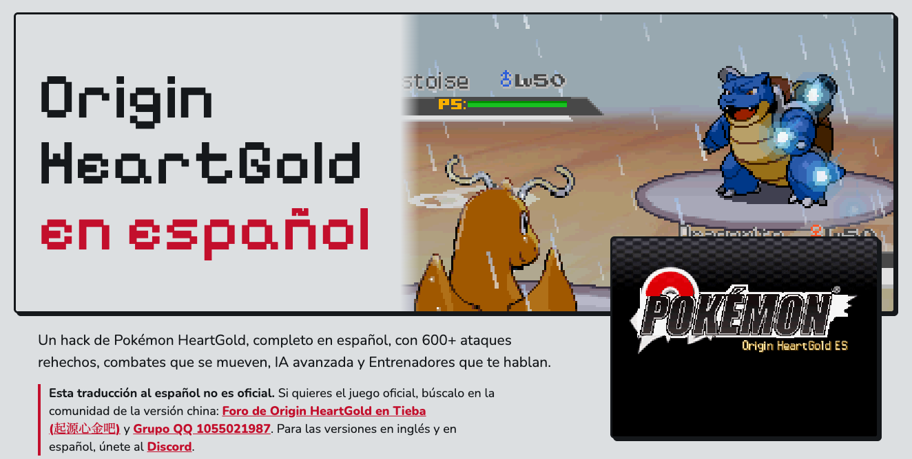

# Origin HeartGold en español

Un hack de Pokémon HeartGold, completo en español, con 600+ ataques rehechos, combates que se mueven, IA avanzada y Entrenadores que te hablan.

## Parchea desde el navegador

Ve a la sección ["Parchear"](https://luisvent.github.io/origin-es/#parchear) y elige tu ROM: el navegador la revisa, la parchea y te deja guardarla. Todo pasa en tu propio equipo: no se sube nada a ningún lado.

## Qué necesitas

Tu propia copia de Pokémon HeartGold (USA), sin parches, con CRC32 `C180A0E9`. Aquí no hay ROMs ni enlaces a ellas.

## Qué es esto

Un proyecto de fans, gratis y sin fines de lucro, no afiliado a Nintendo, Game Freak, Creatures ni The Pokémon Company.

**Esta traducción al español no es oficial.** Si quieres el juego oficial, búscalo en la comunidad de la versión china:

- [Foro de Origin HeartGold en Tieba (起源心金吧)](https://tieba.baidu.com/f?kw=%E8%B5%B7%E6%BA%90%E5%BF%83%E9%87%91)
- [Grupo QQ 1055021987](https://qm.qq.com/q/ciowpoZdqE)

Para las versiones en inglés y en español, únete al [Discord](https://discord.gg/AT9U3xPUb).
